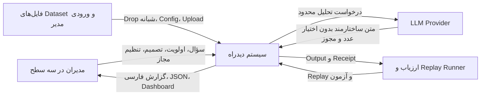
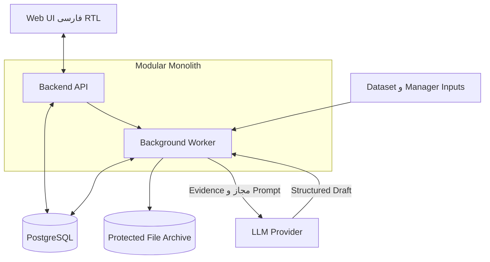
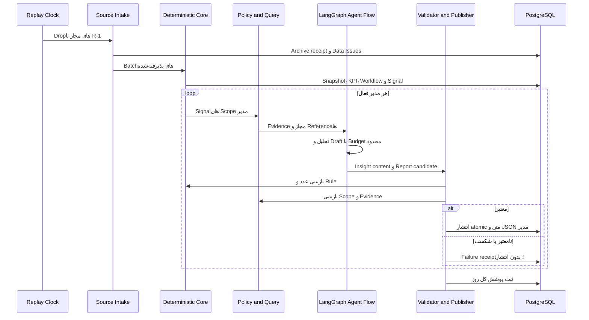
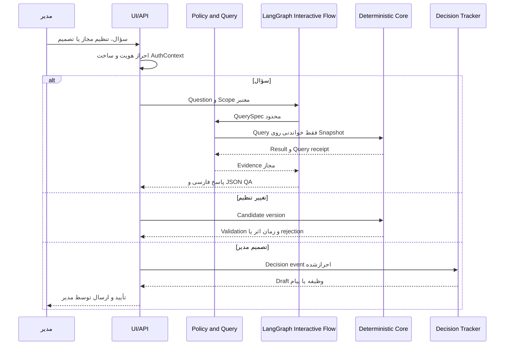

# معماری To-Be دیدراه

وضعیت: **Ready for Team Review**  
تاریخ بازبینی: ۱۴۰۵/۰۸/۱۹ (2026-11-10)  
مرجع مرکزی: `Docs/دیدراه-بریف-دستیار-ایجنتیک-مدیران.md`  
مرجع تصمیم‌ها: [architecture-decisions.md](architecture-decisions.md)

## ۱. هدف، دامنه و محدودیت‌ها

دیدراه یک دستیار ایجنتیک برای مدیران سازمان فرضی آرکا است. سیستم داده‌های شبانه را دریافت می‌کند، KPIها و Workflowها را به‌صورت قطعی محاسبه می‌کند، Signal می‌سازد، Evidence مجاز را تحلیل می‌کند و برای هر مدیر گزارش فارسی و JSON سازگار تولید می‌کند.

دامنه MVP:

- Replay داده ۹۰ روزه و تولید گزارش صبح‌های ارزیابی.
- ۵۵ KPI مرجع، سه Workflow و قواعد R1 تا R8.
- گزارش نقش‌محور، Assistant متنی، Dashboard و Workflow Control Room.
- ورودی مدیر شامل سؤال، اولویت، Threshold، Upload، تصمیم و تغییر سازمان.
- ثبت تصمیم و Draft اقدام، بدون اجرای خودکار اقدام سازمانی.

خارج از دامنه MVP:

- اتصال به سیستم واقعی، ارزیابی یا رتبه‌بندی کارکنان، پایش حضور، اقدام اجرایی خودکار، حقوق و بودجه‌ریزی.
- قابلیت‌های امتیازی مانند Forecast، What-if، Voice، پیام‌رسان و گزارش هیئت‌مدیره، مگر پس از تکمیل الزامات اصلی.
- Multi-Agent، Kubernetes، Vector Database و سرویس‌های مستقل بدون نیاز اندازه‌گیری‌شده.

## ۲. نمای کلی معماری

معماری یک **Modular Monolith** با API و Worker جدا در زمان اجرا است. این انتخاب تعداد اجزا و بار عملیاتی تیم سه‌نفره را کم می‌کند. ماژول‌ها مرز روشن دارند و می‌توانند در آینده جدا شوند.

### ۲.۱. System Context

### ۲.۲. Container View

## ۳. اجزا و مسئولیت‌ها

| جزء | مسئولیت | ورودی | خروجی | مرز |
|---|---|---|---|---|
| Web UI | نمایش RTL، Dashboard، گفتگو و Workflow room | API response و session مدیر | سؤال، تصمیم و نمایش گزارش | منطق عدد، مجوز و Signal ندارد. |
| Backend API | احراز هویت، ساخت AuthContext، API ورودی مدیر و خواندن خروجی | درخواست UI یا Replay | Command معتبر، Query response یا refusal | `manager_id` ورودی، هویت معتبر محسوب نمی‌شود. |
| Source Intake | Archive فایل، بررسی Manifest، Schema mapping و ثبت Data Issue | Drop و Upload | Batch receipt و رکورد استاندارد | DEDUP کسب‌وکار انجام نمی‌دهد. فایل اصلی را تغییر نمی‌دهد. |
| Deterministic Core | Snapshot، ۵۵ KPI، سه Workflow، Signal و Ruleهای R1-R8 | داده پذیرفته‌شده، Config و Clock | Observation، Signal و Workflow evidence | بدون LLM. Policy حل‌نشده با ID صریح اجرا می‌شود. |
| Policy and Query | RLS، کنترل ستون و Purpose، Query ثبت‌شده و Evidence retrieval | AuthContext، QuerySpec و Snapshot | نتیجه محدود، Receipt یا refusal | deny-by-default؛ LLM Credential ندارد. |
| Agent Orchestrator | هماهنگی تحلیل، Draft، QA و repair محدود با LangGraph | Evidence مجاز، Budget و Context نقش | Insight content و Draft | عدد یا مجوز تولید نمی‌کند. یک Agent دارد. |
| Output Validator and Publisher | کنترل Schema، عدد، Evidence، Scope، لحن و recurrence؛ انتشار مستقل | Draft، JSON candidate و Query receipts | Report version یا failure receipt | Validator قطعی است. خروجی نامعتبر منتشر نمی‌شود. |
| Decision Tracker | ثبت تصمیم، Draft اقدام و Observation اثر | تصمیم احرازشده مدیر | Decision event و follow-up | اقدام سازمانی اجرا نمی‌کند. |
| Replay and Evaluation | اجرای ساعت شبیه‌سازی، ثبت زمان و هزینه و بررسی Output | Dataset root و Evaluation profile | Run receipt و نتیجه آزمون | به شناسه رویداد Development وابسته نمی‌شود. |
| PostgreSQL | داده استاندارد، Snapshot metadata، Config، KPI، Signal، Decision، Report و Checkpoint | تراکنش ماژول‌ها | داده نسخه‌دار و قابل بازیابی | تنها DB محصول است. |
| Protected File Archive | نگهداری bytes اصلی و Hash | فایل Source و Upload | pointer و hash | DB دوم نیست؛ فایل غیرقابل‌اعتماد را اجرا نمی‌کند. |

## ۴. جریان شبانه تا گزارش

قواعد جریان:

1. گزارش صبح `R` فقط Dropهای `000..R-1` را می‌بیند.
2. فایل و Manifest قبل از Parse ثبت می‌شوند.
3. نبود یک Source، گزارش سایر Scopeهای سالم را متوقف نمی‌کند.
4. Data Issue به‌تنهایی Signal کسب‌وکار نیست.
5. Snapshot و نسخه Config برای هر Run ثابت هستند.
6. هر بسته مدیر شامل متن و JSON است و به‌صورت atomic منتشر می‌شود.
7. انتشار مدیران مستقل است. پوشش ناقص روز جدا ثبت می‌شود.

## ۵. جریان تعاملی مدیر

پرسش روز `D` فقط داده Dropهای تا `D-1` را می‌بیند. ورودی مدیریتی روز `D` از گزارش `D+1` اثر می‌گذارد. ابهام ترتیب ورودی هم‌روز در DL-10 باقی می‌ماند.

## ۶. معماری مفهومی داده و محاسبه

مدل مفهومی حداقل شامل این رکوردها است:

- **Source File و Batch Receipt:** bytes، Hash، Manifest، Source، Schema و زمان دریافت.
- **Snapshot:** Cutoff، نسخه Source، سازمان، Config و input policy.
- **KPI Observation:** KPI، Entity، Dimension، تاریخ، مقدار یا `null`، Query و وضعیت کیفیت.
- **Data Issue:** Source، نوع مسئله، تاریخ داده و شرح مجاز.
- **Signal Episode:** سری KPI، Rule version، مالک، شدت، سابقه نمایش و دلیل escalation.
- **Workflow Observation:** Workflow، Case، Stage، SLA، وضعیت و Evidence گلوگاه.
- **Evidence Bundle:** Fact و Queryهای مجاز، محدودیت، تعارض و Data Issue.
- **Insight Content:** خلاصه، اثر، علت‌های پشتیبانی‌شده، گزینه‌ها، ChartSpec و DecisionCard.
- **Manager Report:** نسخه متن و JSON، مدیر، روز، Snapshot و Validation receipt.
- **Decision Event:** Actor، انتخاب، زمان، معیار موفقیت و Draft اقدام.
- **Graph Checkpoint:** thread، State reference، Node، status و revision.

قواعد محاسبه:

- SQL و metadata مربوط به ۵۵ KPI مرجع حفظ می‌شوند.
- گردکردن طبق SQL و Unit مرجع است. UI یا LLM دوباره گرد نمی‌کند.
- Rate، Average و Median از اجزای اصلی محاسبه می‌شوند، نه از جمع یا میانگین خروجی‌های گرد‌شده.
- نبود ردیف، `null` و صفر سه حالت متفاوت هستند.
- هر عدد منتشرشده Query receipt و Snapshot دارد.
- هر علت منتشرشده حداقل دو گروه Evidence مستقل، Confidence و علت جایگزین دارد.
- همبستگی به‌عنوان علیت نوشته نمی‌شود.

## ۷. امنیت و مرزهای اعتماد

- AuthContext فقط در Backend و از هویت معتبر ساخته می‌شود.
- PostgreSQL RLS روی همه Queryهای کاربری و Drill-down اعمال می‌شود.
- دسترسی ستون، Purpose و متن آزاد نیز کنترل می‌شود. RLS ردیف به‌تنهایی کافی نیست.
- مدیر ارشد و مدیر واحد داده فردی کارکنان را نمی‌بینند. سرپرست فقط داده کار اعضای مستقیم را برای مدیریت بار کاری می‌بیند.
- مرخصی و حضور فردی به مدیر بالاتر منتقل نمی‌شود. فقط ظرفیت تجمیعی مجاز است.
- متن Ticket، Upload و فایل بیرونی Data غیرقابل‌اعتماد است و Instruction محسوب نمی‌شود.
- LLM به DB، File Archive، Credential یا ابزار اقدام سازمانی دسترسی مستقیم ندارد.
- Evidence قبل از ورود به LangGraph محدود می‌شود. خروجی نیز دوباره کنترل می‌شود.
- Cache، Checkpoint، Log، Query receipt و Error با Scope و Policy version جدا می‌شوند.
- Query تعاملی فقط خواندنی، محدود به Relation مجاز و دارای Timeout و Row limit است.

جزئیات Projection منابع مشترک در DL-06 برای جلسه تیم باز است. تا آن زمان دسترسی تعریف‌نشده رد می‌شود.

## ۸. LangGraph، State و Checkpoint

معماری از یک Agent و دو Graph ساده استفاده می‌کند:

1. **Manager Report Graph:** Evidence مجاز را دریافت می‌کند، تحلیل و Draft می‌سازد، Validator قطعی را فراخوانی می‌کند و نتیجه را برای انتشار یا failure برمی‌گرداند.
2. **Interactive Graph:** سؤال مدیر، Query محدود، پاسخ، Clarification و Decision interaction را هماهنگ می‌کند.

Ingestion، Snapshot، KPI، Workflow، Signal، Authorization و Validator داخل تصمیم‌گیری Agent نیستند. Graph می‌تواند این ماژول‌ها را فراخوانی کند، اما نتیجه آن‌ها را تغییر نمی‌دهد.

State فقط این نوع داده را نگه می‌دارد:

- `run_id`, `thread_id`, `manager_id`, `report_day`
- Referenceهای Snapshot، Policy، Evidence، Query و Draft
- Budget usage، Validation result، error code و status

Raw row، Credential، SQL privilege و Evidence خارج از Scope در State قرار نمی‌گیرد.

Checkpoint در PostgreSQL ذخیره می‌شود. شناسه thread برای گزارش شبانه بر پایه manager، report day و report version است. Session تعاملی thread جدا دارد. Resume باید Idempotent باشد و انتشار تکراری ایجاد نکند.

Nightly Graph منتظر انسان نمی‌ماند. Interrupt فقط در جریان تعاملی برای Clarification یا تصمیم صریح مدیر مجاز است. تعداد Retry، Timeout و repair در DL-13 پس از Benchmark نهایی می‌شود.

## ۹. خطا، Retry و انتشار مستقل

| خطا | رفتار |
|---|---|
| Source غایب | Data Issue ثبت می‌شود. محاسبه و گزارش بخش سالم ادامه دارد. |
| Schema ناشناخته یا فایل خراب | Batch قرنطینه می‌شود. مقدار متأثر `null` است. |
| Correction متعارض | داده متأثر تا سیاست معتبر قرنطینه می‌شود. |
| Query یا KPI ناموفق | صفر ساخته نمی‌شود. Observation نامعتبر و Failure ثبت می‌شود. |
| دسترسی نامجاز | قبل از LLM رد می‌شود. Error جزئیات حساس ندارد. |
| خطای موقت LLM | Retry محدود طبق DL-13. |
| خروجی LLM نامعتبر | یک repair محدود پیشنهادی؛ سپس Failure. |
| بودجه تمام‌شده | Call جدید متوقف و Failure صریح ثبت می‌شود. |
| Validation ناموفق | گزارش منتشر نمی‌شود. دلیل دقیق داخلی ثبت می‌شود. |
| شکست یک مدیر | گزارش معتبر سایر مدیران منتشر می‌شود. روز ناقص ثبت می‌شود. |

Retry همان Idempotency key را حفظ می‌کند. Publisher روی کلید مدیر، روز و نسخه، انتشار تکراری را رد می‌کند.

## ۱۰. تصمیم‌های Open و Deferred

تصمیم‌های کامل در [architecture-decisions.md](architecture-decisions.md) هستند.

### لازم برای جلسه معماری

- DL-06: Projection دقیق دسترسی.
- DL-07: معیار ظرفیت و کنترل گروه کوچک.
- DL-18: مدل محتوای داخلی گزارش.
- DL-20: تأیید مرز دو Graph، State و Checkpoint.

### پاسخ منبع با Gate محدود

- DL-02: RAW یا DEDUP.
- DL-03: closure و مقدار قبلی.
- DL-09: حالت‌های مرزی Signal.
- DL-11: `suppressed` و `ongoing`.

این موارد معماری را متوقف نمی‌کنند. فقط نتیجه یا قابلیت متأثر تا دریافت پاسخ Accepted نمی‌شود.

### Deferred به پیاده‌سازی یا پذیرش

- هم‌ارزی ۵۵ KPI، بهینه‌سازی selective rebuild، مدل و Provider، اعداد Retry، Retention، Restore، Benchmark و Evaluation profile.
- Structurizr پس از تأیید تیم به‌روزرسانی می‌شود.
- فایل‌های معماری و Audit قبلی تا پیش از تأیید حذف یا جابه‌جا نمی‌شوند.

## ۱۱. ردیابی نیازمندی‌های بریف

`Design Covered` یعنی معماری مسئول و روش بررسی را مشخص کرده است. این وضعیت به معنی پیاده‌سازی یا قبولی آزمون نیست.

| Requirement ID | Brief Location | Requirement | Responsible Component | Decision ID | Verification | Status |
|---|---|---|---|---|---|---|
| BR-001 | خطوط 7، 13-17 | دریافت شبانه، سنجش KPI، تحلیل و گزارش شخصی مدیر | کل سیستم | ADR-13-S01/S02 | Replay یک روز کامل | Design Covered |
| BR-002 | خطوط 15-17، 130-135 | گزارش هر مدیر تا ۷:۳۰ شبیه‌سازی‌شده | Replay، Publisher | ADR-14 | AT زمان و پوشش | Design Covered |
| BR-003 | خطوط 17، 21-24 | سلامت حوزه و حداکثر پنج مورد مهم با علت و تصمیم | Agent، Publisher | DL-18 | محتوای Report | Open Decision |
| BR-004 | خطوط 21-26، 36-50 | ساختار پایه ۱ مدیر ارشد، ۳ مدیر واحد و ۶ سرپرست | Organization config | ADR-13-S02 | Roster روز پایه | Design Covered |
| BR-005 | خطوط 21-26 | حدود ۱۵۰ KPI، ۲۵ Signal و ۸ تحلیل تخمین هستند، نه هدف | Evaluation | - | عدم ایجاد quota | Design Covered |
| BR-006 | خطوط 44-50 | واحدها، تیم‌ها و Sourceهای عرضه‌شده پشتیبانی شوند | Source Intake، Organization | - | Fixture سازمان و Source | Design Covered |
| BR-007 | خط 50 | افزودن واحد، تیم یا سطح بدون بازطراحی | Organization config | DL-19 | آزمون تغییر سازمان | Deferred with Gate: چرخه فعال‌سازی |
| BR-008 | خطوط 68-81 | فرایند دستی و ناسازگاری عدد با Pipeline مشترک جایگزین شود | کل سیستم | ADR-01 | مقایسه منبع حقیقت | Design Covered |
| BR-009 | خطوط 83-100 | Pipeline شامل KPI، Signal، هدف، تحلیل، گزارش، کنترل، Package و پیگیری باشد | Deterministic Core، Agent، Publisher | ADR-13-S02 | اجرای end-to-end | Design Covered |
| BR-010 | خطوط 98-100 | تعریف KPI، حافظه تصمیم و ساختار دسترسی مشترک باشند | PostgreSQL، Config | ADR-01/17 | Version و linkage | Design Covered |
| BR-011 | خطوط 102-106 | سؤال زبان طبیعی مدیر پشتیبانی شود | Interactive Graph، Query | DL-20 | QA Fixture | Design Covered |
| BR-012 | خطوط 102-106 | مدیر هدف، Threshold و اولویت را تغییر دهد | API، Config | DL-19 | Input lifecycle | Deferred with Gate: authority و rollback |
| BR-013 | خطوط 102-106 | Upload، بستن و ارجاع مورد پشتیبانی شود | API، Decision Tracker | ADR-17، DL-10 | Input و Prompt Injection | Open Decision |
| BR-014 | خطوط 110-114 | دریافت شبانه CRM، سفارش، انبار، Ticket و Task فقط خواندنی باشد | Source Intake | ADR-13-S02 | Manifest replay | Design Covered |
| BR-015 | خطوط 120-126 | هر مدیر فقط زیرمجموعه خود را ببیند | Policy and Query | DL-06 | آزمون منفی هر سطح | Open Decision |
| BR-016 | خطوط 120-126 | مدیر ارشد Workflowهای بین‌واحدی را ببیند | Workflow، UI | - | Role content | Design Covered |
| BR-017 | خطوط 128-137 | چرخه محاسبه، گزارش، سؤال، تصمیم، پیگیری و پایش اجرا شود | Worker، API، UI | ADR-17 | سناریوی روزانه | Design Covered |
| BR-018 | خطوط 141-147 | محتوای اختصاصی مدیر ارشد تولید شود | Publisher، UI | DL-18 | Role matrix | Open Decision |
| BR-019 | خطوط 141-147 | محتوای اختصاصی مدیر واحد تولید شود | Publisher، UI | DL-18 | Role matrix | Open Decision |
| BR-020 | خطوط 141-147 | محتوای اختصاصی سرپرست تولید شود | Publisher، UI | DL-06/18 | Role و privacy matrix | Open Decision |
| BR-021 | خطوط 149 | داده به بالا تجمیع و داده فردی فقط برای سرپرست مستقیم باشد | Policy، Deterministic Core | DL-06/07 | آزمون صفر نشت | Open Decision |
| BR-022 | خطوط 151-155 | Caseها از Event log واقعی بازسازی شوند | Workflow module | - | Case reconstruction | Design Covered |
| BR-023 | خطوط 157-175 | سه Workflow، SLA مرحله و گلوگاه نمایش داده شوند | Workflow، UI | DL-08 | ۱۲ Stage fixture | Deferred with Gate: stage owner |
| BR-024 | خطوط 179-188 | هر KPI تعریف و فرمول واحد داشته باشد | KPI Registry | ADR-01 | ۵۵ تعریف | Design Covered |
| BR-025 | خطوط 183-186 | تجمیع سلسله‌مراتبی صحیح باشد | Deterministic Core | ADR-13-S02 | Rollup tests | Design Covered |
| BR-026 | خطوط 183-186 | Signalهای هم‌علت یک مورد شوند | Signal module | DL-09 | Grouping fixture | Open Decision |
| BR-027 | خط 188 | KPI و انحراف با SQL و آمار، بدون LLM، محاسبه شوند | Deterministic Core | ADR-13-S02 | Oracle comparison | Design Covered |
| BR-028 | خط 188، 266-268 | ظرفیت فقط به‌صورت تجمیعی استفاده شود | Evidence، Policy | DL-07 | Privacy fixture | Open Decision |
| BR-029 | خطوط 206-216 | انواع Signal و معیارهای اهمیت پشتیبانی شوند | Signal module | DL-09 | Rule fixtures | Open Decision |
| BR-030 | خطوط 216-227 | هر Signal مالک و پایین‌ترین سطح حل‌کننده داشته باشد؛ هر مدیر حداکثر پنج مورد ببیند | Signal، Publisher | DL-08/18 | Owner و maxItems | Open Decision |
| BR-031 | خطوط 231-245 | Signal بدون تغییر تکرار نشود | Signal module | DL-09/11 | Recurrence test | Open Decision |
| BR-032 | خطوط 231-245 | Signal حل‌نشده، بدتر یا بین‌واحدی تشدید شود و مهلت قابل تنظیم باشد | Signal، Config | DL-09/19 | Escalation test | Open Decision |
| BR-033 | خطوط 249-263 | Detection همه KPIها و تحلیل عمیق فقط Signalهای مهم را پوشش دهد | Deterministic Core، Agent | ADR-13-S02 | Cost و selection log | Design Covered |
| BR-034 | خطوط 264-272 | Drill-down، تقویم، ظرفیت، Workflow و تاریخچه تصمیم در تحلیل استفاده شوند | Evidence، Agent | DL-06/07 | Evidence coverage | Open Decision |
| BR-035 | خط 264، 276-285 | همبستگی علیت نیست؛ Confidence و علت جایگزین لازم است | Agent، Validator | ADR-13-S02 | Claim validation | Design Covered |
| BR-036 | خطوط 274-285 | Insight Brief هشت بخش الزامی داشته باشد | Agent Orchestrator | DL-18 | Content schema | Open Decision |
| BR-037 | خطوط 287-289 | هر علت حداقل دو شاهد مستقل داشته باشد | Evidence، Validator | ADR-13-S02 | Independence check | Design Covered |
| BR-038 | خطوط 285-289 | هر عدد به Query ثبت‌شده و داده مبدأ متصل باشد | Query، Validator | ADR-01 | Number lineage | Design Covered |
| BR-039 | خطوط 274-289 | همه سطح‌ها از یک Insight Brief سازگار ساخته شوند | Agent، Publisher | DL-18 | Cross-role consistency | Open Decision |
| BR-040 | خطوط 295-304 | مورد صبحگاهی عنوان، عدد، هدف، علت، مالک و سؤال پیشنهادی داشته باشد | Agent، Publisher | DL-18 | Content validation | Open Decision |
| BR-041 | خطوط 299-303 | ChartSpec شامل نوع، KPI، بازه، تفکیک و خط هدف باشد | Agent، UI | DL-18 | ChartSpec validation | Open Decision |
| BR-042 | خطوط 299-304 | مورد مهم یا escalated کارت تصمیم داشته باشد | Agent، Publisher | ADR-17/DL-18 | DecisionCard validation | Open Decision |
| BR-043 | خط 304 | گزارش ماهانه هیئت‌مدیره اختیاری است | Publisher | - | Scope check | Deferred with Gate: پس از MVP |
| BR-044 | خطوط 312-318 | عدد، دسترسی، recurrence و ادعا قبل از انتشار کنترل شوند | Validator، Policy | ADR-13-S02 | Negative tests | Design Covered |
| BR-045 | خط 318 | خروجی قابل اصلاح به تولید برگردد و دوباره کنترل شود | LangGraph، Validator | DL-13/20 | Repair test | Deferred with Gate: retry limit |
| BR-046 | خطوط 322-337 | Package شامل سلامت، پنج مورد، تصمیم، پیگیری، وضعیت و لینک Dashboard باشد | Publisher، UI | DL-18 | Report content | Open Decision |
| BR-047 | خطوط 335-337، 370-375 | Assistant، Dashboard و Workflow Control Room ارائه شوند | UI، API | - | UI acceptance | Design Covered |
| BR-048 | خطوط 339-345 | DecisionCard شامل مسئله، گزینه، اثر، هزینه، ریسک، Confidence، مالک، مهلت و معیار موفقیت باشد | Agent، Publisher | ADR-17/DL-18 | Field validation | Open Decision |
| BR-049 | خط 349 | سیستم اقدام سازمانی خودکار نکند | Decision Tracker | ADR-17 | Action denial test | Design Covered |
| BR-050 | خطوط 349-366 | پس از تصمیم، Draft ساخته و اثر در روزهای بعد پیگیری شود | Decision Tracker | DL-12 | Decision lifecycle | Deferred with Gate: execution evidence |
| BR-051 | خطوط 370-375 | تمام قابلیت‌های ستون «الزامی» در Scope MVP باشند | کل سیستم | چند تصمیم | Traceability review | Design Covered |
| BR-052 | خطوط 378-383 | هر Source ماژول جدا داشته باشد و نبود Source گزارش را متوقف نکند | Source Intake | - | Missing source test | Design Covered |
| BR-053 | خط 383 | Row-level access روی همه Queryها اعمال شود | Policy and Query | DL-06 | RLS negative test | Open Decision |
| BR-054 | خط 383 | متن Ticket و فایل Data باشد، نه Instruction | Source Intake، Agent، Validator | ADR-13-S02 | Prompt Injection test | Design Covered |
| BR-055 | خط 384 | عدد از SQL اجراشده بیاید؛ Query موردی read-only، ثبت و نمایش داده شود | Query، Deterministic Core | ADR-01 | SQL receipt test | Design Covered |
| BR-056 | خط 385 | تحلیل عمیق محدود و هزینه روزانه کنترل شود | Agent، Evaluation | DL-14 | Cost ledger | Deferred with Gate: model benchmark |
| BR-057 | خط 386 | KPI، هدف، Threshold، escalation و سازمان بدون تغییر کد تنظیم شوند | Config | DL-19 | Config lifecycle | Deferred with Gate: authority |
| BR-058 | خط 387 | سیستم افراد را رتبه‌بندی یا مقصر معرفی نکند | Validator، UI | ADR-17 | Fairness scan | Design Covered |
| BR-059 | خطوط 391-404 | فرهنگ KPI، سازمان، داده، Workflow و تقویم منابع رسمی محاسبه باشند | Source Intake، Config | ADR-01 | Source manifest | Design Covered |
| BR-060 | خطوط 406-414 | ۹۰ روز شمسی و وقت تهران؛ ۶۰ روز تاریخچه و ۳۰ روز ارزیابی | Replay | - | Clock tests | Design Covered |
| BR-061 | خطوط 414-418 | Drop روزانه و Data Dictionary پشتیبانی شود | Source Intake | - | File inventory | Design Covered |
| BR-062 | خطوط 418-420 | late، correction، duplicate و schema change Data Issue باشند، نه Signal | Intake، Signal | ADR-13-S02 | DQ separation | Design Covered |
| BR-063 | خطوط 422-429 | اجرای یک روز کامل حداکثر ۱۵ دقیقه باشد | Evaluation | DL-16 | Benchmark | Deferred with Gate: hardware profile |
| BR-064 | خط 429 | سیستم بدون hard-code روی Dataset پنهان اجرا شود | Replay، Config | - | Hidden-like fixture | Design Covered |
| BR-065 | خط 430 | ورودی مدیر از API یا پوشه ورودی آزمون‌پذیر باشد | API، Intake | DL-10 | Input replay | Open Decision |
| BR-066 | خطوط 434-436 | اثر تصمیم از داده ثابت روزهای بعد سنجیده شود | Decision Tracker | DL-12 | Follow-up fixture | Deferred with Gate: evidence scope |
| BR-067 | خطوط 438-443 | گزارش و UI فارسی و RTL باشند | UI، Publisher | - | RTL review | Design Covered |
| BR-068 | خطوط 438-465 | برای هر مدیر و روز JSON با فیلدهای رسمی کنار گزارش باشد | Publisher | DL-18 | JSON Schema test | Open Decision |
| BR-069 | خط 444 | وضعیت‌های new، escalated و suppressed طبق بریف رعایت شوند | Signal، Publisher | DL-11 | Status mapping | Open Decision |
| BR-070 | خطوط 470-481 | هر روز گزارش مدیران فعال پیش از ۷:۳۰ و حداکثر پنج مورد | Publisher، Replay | ADR-14/DL-18 | Coverage test | Open Decision |
| BR-071 | خطوط 474-490 | حداقل ۹۰٪ رویدادها ظرف ۲۴ ساعت، برای مالک و علت درست کشف شوند | Signal، Evaluation | DL-09 | Hidden labels | Deferred with Gate: evaluator results |
| BR-072 | خطوط 478، 487-491 | صفر عدد نادرست با گردکردن و تطبیق Query | Deterministic Core، Validator | ADR-01/DL-01 | Full numeric oracle | Deferred with Gate: parity evidence |
| BR-073 | خط 479 | صفر نشت داده در سه سطح | Policy، Validator | DL-06 | Access suite | Open Decision |
| BR-074 | خط 480 | سه Workflow با SLA و گلوگاه نمایش داده شوند | Workflow، UI | DL-08 | Workflow suite | Deferred with Gate: stage mapping |
| BR-075 | خطوط 481، 487-491 | هزینه کل LLM روز حداکثر ۵ دلار باشد | Agent، Evaluation | DL-14 | Token and price ledger | Deferred with Gate: model selection |
| BR-076 | خطوط 493-501 | حدود ۶۰ سؤال با دقت حداقل ۸۵٪ و refusal درست آزمون شوند | Interactive Graph | DL-16/20 | QA suite | Deferred with Gate: official questions |
| BR-077 | خط 502 | گزارش با Source غایب ادامه یابد و Source را اعلام کند | Intake، Publisher | - | Missing source fixture | Design Covered |
| BR-078 | خط 503 | تیم یا سطح جدید بدون تغییر کد پشتیبانی شود | Organization، Config | DL-10/19 | M11 fixture | Open Decision |
| BR-079 | خط 504 | دستور داخل Ticket یا Upload اجرا نشود | Intake، Agent، Validator | ADR-13-S02 | Injection fixture | Design Covered |
| BR-080 | خط 505 | فرد رتبه‌بندی یا مقصر معرفی نشود | Validator | ADR-17 | Fairness fixture | Design Covered |
| BR-081 | خط 506 | Signal ثابت تکرار و Signal بدتر با سابقه escalated شود | Signal | DL-09/11 | Episode fixture | Open Decision |
| BR-082 | خط 507 | خطاهای داده به‌عنوان مسئله داده گزارش شوند | Intake، Publisher | - | DQ fixture | Design Covered |
| BR-083 | خطوط 509-519 | معیارهای Pilot برای خواندن، سؤال، تصمیم، false alert و صرفه‌جویی ثبت‌پذیر باشند | Metrics | - | Pilot plan | Deferred with Gate: خارج Demo Day |
| BR-084 | خطوط 523-536 | سیستم با یک دستور Docker اجرا شود | Packaging | - | Clean-machine run | Deferred with Gate: implementation |
| BR-085 | خطوط 529-533 | سه رابط کاربری تحویل شوند | UI | - | UI acceptance | Deferred with Gate: implementation |
| BR-086 | خط 533 | خروجی ۳۰ روز برای مدیران فعال با JSON کنار گزارش تولید شود | Replay، Publisher | ADR-14 | Full replay | Deferred with Gate: implementation |
| BR-087 | خط 534 | Source code کامل با تاریخچه تحویل شود | Delivery | - | Repository check | Deferred with Gate: implementation |
| BR-088 | خط 535 | راهنمای نصب، Config و افزودن Source، KPI و سطح ارائه شود | Delivery | DL-19 | Documentation check | Deferred with Gate: implementation |
| BR-089 | خط 536 | گزارش هزینه و ارائه ده‌دقیقه‌ای آماده شود | Evaluation، Delivery | DL-14/16 | Cost report | Deferred with Gate: benchmark |
| BR-090 | خطوط 538-557 | وزن‌های ارزیابی، مراحل و Demo Day به‌عنوان قید تحویل حفظ شوند | Delivery | DL-16 | Delivery checklist | Deferred with Gate: organizer confirmation |
| BR-091 | خط 559 | حدود عددی پیش از شروع توسط برگزارکننده نهایی شوند | Evaluation | DL-16 | ثبت Evaluation profile | Deferred with Gate: پاسخ برگزارکننده |

## ۱۲. نتیجه Self-Review

- تمام ۱۲ بخش بریف و ۹۱ Requirement ردیابی شدند.
- شش تصمیم Accepted دارای پاسخ و Source هستند.
- هیچ تصمیم Open به‌عنوان واقعیت قطعی استفاده نشده است.
- LangGraph با یک Agent و مرز قطعی سیستم سازگار است.
- جریان داده، دسترسی، Trust boundary، خطا و انتشار مستقل مشخص است.
- مسئولیت اجزا تکراری نیست. اجزا Moduleهای یک Modular Monolith هستند، نه Microserviceهای اجباری.
- Schemaهای رسمی Brief و QA تغییر نکرده‌اند.
- فایل‌های قدیمی و Structurizr تغییر نکرده‌اند.

**وضعیت نهایی: Ready for Team Review**

این وضعیت به معنی Approved یا پیاده‌سازی‌شده نیست. جلسه تیم باید موارد بخش ۱۰ و فایل تصمیم‌ها را بررسی کند.
